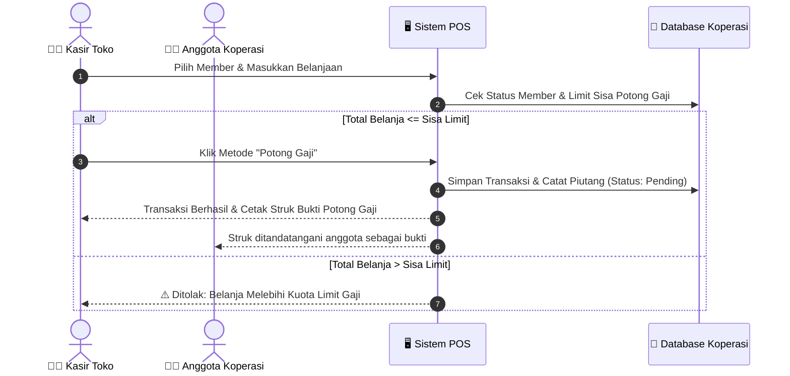

# 📖 BUKU PANDUAN PENGGUNA & ADMINISTRATOR
# SISTEM POINT OF SALE (POS) & MANAJEMEN KOPERASI KARYAWAN

> **Versi Aplikasi**: 1.5.5  
> **Target Pengguna**: Kasir Koperasi, Staf Administrasi/Gudang, Staf HR/Payroll, Manajer Operasional, & Pengelola/Owner Koperasi  
> **Lisensi & Hosting**: 100% Mandiri (Self-Hosted), Offline-First, Bebas Biaya Langganan Cloud  

---

## DAFTAR ISI

1. [Bab 1: Gambaran Umum & Arsitektur Sistem](#bab-1-gambaran-umum--arsitektur-sistem)
2. [Bab 2: Panduan Persiapan Hardware & Instalasi PC Kasir](#bab-2-panduan-persiapan-hardware--instalasi-pc-kasir)
3. [Bab 3: Konfigurasi Jaringan & Akses Web Kantor (LAN)](#bab-3-konfigurasi-jaringan--akses-web-kantor-lan)
4. [Bab 4: Pengelolaan Akun, Keamanan & Hak Akses (Granular RBAC)](#bab-4-pengelolaan-akun-keamanan--hak-akses-granular-rbac)
5. [Bab 5: Panduan Operasional Kasir (Electron Desktop)](#bab-5-panduan-operasional-kasir-electron-desktop)
   - 5.1 Membuka Aplikasi & Login Kasir
   - 5.2 Antarmuka Layar Kasir (POS)
   - 5.3 Pemindaian Barcode & Pencarian Cepat Sembako
   - 5.4 Penjualan Anggota (Member) vs Non-Anggota
   - 5.5 Pembayaran Tunai (Cash) & Cetak Struk
   - 5.6 Pembayaran Khusus "Potong Gaji" & Validasi Limit
   - 5.7 Void / Pembatalan Transaksi Kasir
6. [Bab 6: Panduan Operasional Web Admin Kantor (Office Web)](#bab-6-panduan-operasional-web-admin-kantor-office-web)
   - 6.1 Dashboard Ringkasan Eksekutif & Analytics
   - 6.2 Manajemen Katalog Produk & Kategori (24.000+ Produk)
   - 6.3 Manajemen Database Anggota / Member Koperasi
   - 6.4 Stok Opname & Penyesuaian Stok (Stock Adjustment)
   - 6.5 Konfirmasi & Rekapitulasi Potong Gaji (Payroll HR)
   - 6.6 Laporan Penjualan, X/Z Report & Laporan Stok Bulanan
   - 6.7 Broadcast Promosi WhatsApp & Manajemen Consent
   - 6.8 Pengaturan Branding Koperasi & Logo Struk
7. [Bab 7: Prosedur Pemeliharaan, Backup & Pemulihan Data (Disaster Recovery)](#bab-7-prosedur-pemeliharaan-backup--pemulihan-data-disaster-recovery)
8. [Bab 8: Panduan Pemecahan Masalah (Troubleshooting)](#bab-8-panduan-pemecahan-masalah-troubleshooting)

---

## BAB 1: GAMBARAN UMUM & ARSITEKTUR SISTEM

Sistem POS Koperasi dirancang khusus untuk memenuhi kebutuhan koperasi simpan pinjam dan sembako karyawan perusahaan. Sistem ini memiliki 2 komponen utama yang terhubung dalam satu jaringan lokal (LAN):

```mermaid
flowchart TD
    subgraph PC_KASIR ["🖥️ PC Kasir (Host Server Utama di Toko)"]
        APP["📱 POS Desktop App (Electron)"]
        API["⚙️ Express API Server (Port 3001)"]
        DB[("💾 Database SQLite (flo.db)\n24.000+ Produk Sembako")]
        PRN["🖨️ Printer Thermal ECO-58D (USB)"]
        SCN["🔫 Barcode Scanner BP-LITE X2D (USB)"]
        UPS["🔋 UPS (Backup Daya Listrik)"]
        
        APP --> API
        API --> DB
        APP --> PRN
        APP --> SCN
        UPS -.-> PC_KASIR
    end

    subgraph PC_KANTOR ["💻 PC Kantor / Ruang HR (Client)"]
        BROWSER["🌐 Web Browser (Chrome / Edge)\nhttp://192.168.1.50:3001"]
    end

    BROWSER <== "Koneksi Jaringan Lokal (LAN / WiFi Kantor)" ==> API
```

### Prinsip Utama Sistem:
1. **Satu Sumber Kebenaran Data (*Single Source of Truth*)**: Database SQLite (`flo.db`) tersimpan secara aman di PC Kasir. PC Kantor mengakses data melalui REST API yang terenkripsi dan terautentikasi JWT.
2. **Offline-First & Mandiri**: Transaksi kasir tetap berjalan 100% lancar tanpa bergantung pada internet.
3. **Data Pribadi Terlindungi**: Sesuai UU PDP, NIK anggota hanya ditampilkan penuh pada pengguna berwenang (Owner/HR), dan disensor otomatis pada layar kasir umum.

---

## BAB 2: PANDUAN PERSIAPAN HARDWARE & INSTALASI PC KASIR

### 2.1 Persiapan Perangkat Keras (Hardware Checklist)
Pastikan seluruh perangkat telah siap sebelum melakukan instalasi software:

| Perangkat | Spesifikasi / Model | Keterangan |
| :--- | :--- | :--- |
| **PC Kasir** | Windows 10/11 64-bit, RAM $\ge$ 4 GB, SSD | Unit utama yang bertindak sebagai kasir & server data. |
| **UPS** | UPS bawaan koperasi | **Wajib dihubungkan** ke PC Kasir untuk mencegah kerusakan database saat pemadaman listrik mendadak. |
| **Printer Struk** | **ECO-58D** Thermal Printer (58mm) | Terhubung via kabel USB ke PC Kasir. |
| **Barcode Scanner** | **BP-LITE X2D** (2D Barcode Reader) | Terhubung via USB (Plug & Play mode HID). |
| **Kertas Thermal** | Roll Thermal 58mm | Kertas struk kasir. |

```text
       [ Stop Kontak PLN ]
               │
               ▼
       [ 🔋 Unit UPS ]
               │
       ┌───────┴────────┐
       ▼                ▼
  [ 🖥️ PC Kasir ]  [ 🖨️ ECO-58D ]
       │                │
       ├─ [ 🔫 BP-LITE ]┘ (Kabel USB)
       └─ [ 🌐 Router LAN ]
```

---

### 2.2 Langkah Instalasi Software di PC Kasir

1. **Siapkan File Installer**:
   Salin file installer `POS Koperasi Setup 1.5.5.exe` ke Desktop atau folder *Downloads* PC Kasir.
2. **Jalankan Installer**:
   - Klik kanan pada `POS Koperasi Setup 1.5.5.exe` → pilih **Run as administrator**.
   - Ikuti langkah pada wizard instalasi:
     - Pilih folder instalasi default (`C:\Program Files\POS Koperasi` atau direktori pilihan).
     - Centang pilihan *Create Desktop Shortcut*.
     - Klik **Install** dan tunggu hingga proses selesai.
3. **Instalasi Driver Printer ECO-58D**:
   - Pasang kabel USB printer ke PC dan nyalakan saklar printer.
   - Install driver resmi Windows untuk printer POS 58mm.
   - Masuk ke *Settings Windows* → *Bluetooth & devices* → *Printers & scanners* → pilih printer → klik **Print test page**. Pastikan kertas keluar dengan teks terbaca.
4. **Menghubungkan Scanner BP-LITE X2D**:
   - Tancapkan USB scanner ke port USB PC Kasir.
   - Scanner akan berbunyi *beep* 1 kali menandakan siap digunakan.
   - Uji coba dengan membuka Notepad dan memindai salah satu barcode barang. Angka barcode akan otomatis terketik di Notepad diikuti tombol Enter.

---

## BAB 3: KONFIGURASI JARINGAN & AKSES WEB KANTOR (LAN)

Agar PC Kantor (Ruang HR/Admin/Gudang) dapat mengakses dashboard melalui browser tanpa instalasi software tambahan, ikuti konfigurasi berikut:

### 3.1 Mengetahui & Mengunci Alamat IP PC Kasir (Static IP / DHCP Reservation)

1. Di PC Kasir, tekan tombol **Windows + R** di keyboard, ketik `cmd`, lalu tekan **Enter**.
2. Ketik perintah:
   ```cmd
   ipconfig
   ```
3. Cari bagian **IPv4 Address** pada adapter jaringan yang aktif (contoh: `192.168.1.50`).
4. *(Disarankan)* Minta staf IT / administrator router untuk mengunci IP tersebut (*DHCP Reservation*) agar alamat IP PC Kasir tidak berubah saat router restart.

---

### 3.2 Membuka Port Firewall di PC Kasir

Agar koneksi dari PC Kantor tidak diblokir oleh Windows Defender Firewall:

1. Di PC Kasir, buka menu pencarian Windows, ketik **Windows Defender Firewall with Advanced Security**, lalu buka aplikasinya.
2. Klik **Inbound Rules** pada panel sebelah kiri → klik **New Rule...** pada panel sebelah kanan.
3. Pilih **Port** → klik **Next**.
4. Pilih **TCP**, dan pada kolom *Specific local ports* masukkan: `3001` → klik **Next**.
5. Pilih **Allow the connection** → klik **Next**.
6. Centang **Domain**, **Private**, dan **Public** → klik **Next**.
7. Beri nama: `POS Koperasi LAN Server` → klik **Finish**.

---

### 3.3 Mengakses dari PC Kantor

1. Nyalakan PC Kasir dan pastikan aplikasi **POS Koperasi** sudah terbuka.
2. Di PC Kantor, buka browser (Google Chrome, Microsoft Edge, Mozilla Firefox).
3. Masukkan alamat URL berikut pada *address bar*:
   ```text
   http://192.168.1.50:3001
   ```
   *(Ganti `192.168.1.50` dengan alamat IP PC Kasir yang Anda catat sebelumnya).*
4. Halaman Login Web Admin Koperasi akan langsung tampil.

---

## BAB 4: PENGELOLAAN AKUN, KEAMANAN & HAK AKSES (GRANULAR RBAC)

### 4.1 Login Pertama & Kewajiban Mengubah Password Owner

Aplikasi telah dilengkapi akun pengelola default awal:
- **Email**: `admin@koperasi.local`
- **Password Awal**: `admin123`

> [!CAUTION]
> **Tindakan Wajib Setelah Instalasi Pertama**:
> Demi keamanan finansial koperasi, password awal `admin123` **HARUS SEGERA DIUBAH** menjadi password kuat (minimal 12 karakter kombinasi huruf besar, huruf kecil, angka, dan simbol).

#### Cara Mengubah Password Owner:
1. Login sebagai `admin@koperasi.local`.
2. Klik menu **Staff & Akses** pada navigasi sidebar.
3. Klik tombol **Edit** (ikon pensil ✏️) pada akun *Pengelola Koperasi*.
4. Masukkan password baru pada kolom password (contoh: `KopTehang#2026!`).
5. Klik **Simpan Perubahan**.

---

### 4.2 Matriks Hak Akses Akun (Role & Granular Permissions)

Sistem menggunakan RBAC (*Role-Based Access Control*) dengan fitur **Grant Access per Section**:

| Section / Modul | Kasir (Cashier) | Manajer (Manager) | Staf HR (Office HR) | Staf Gudang (Inventory) | Owner (Pengelola) |
| :--- | :---: | :---: | :---: | :---: | :---: |
| **Kasir (POS)** | ✅ | ✅ | ❌ | ❌ | ✅ (Full) |
| **Riwayat Pesanan (Orders)** | ✅ | ✅ | ❌ | ❌ | ✅ (Full) |
| **Katalog Produk (Products)** | Read-Only | ✅ Edit/Tambah | ❌ | ✅ Edit/Stok | ✅ (Full) |
| **Stok Opname (Stock Movements)** | ❌ | ✅ | ❌ | ✅ | ✅ (Full) |
| **Data Anggota (Customers/Members)**| ✅ Cari/Pilih | ✅ | ✅ Lengkap+NIK | ❌ | ✅ (Full) |
| **Potong Gaji (Salary Deductions)** | Catat Transaksi | Rekap/Audit | ✅ Konfirmasi HR | ❌ | ✅ (Full) |
| **Laporan & Analytics (Reports)** | ❌ | ✅ | ✅ Rekap Gaji | Laporan Stok | ✅ (Full) |
| **Broadcast WhatsApp** | ❌ | ✅ | ✅ | ❌ | ✅ (Full) |
| **Kelola Staf & Hak Akses (Staff)**| ❌ | ✅ (Bukan Owner)| ❌ | ❌ | ✅ (Full) |
| **Pengaturan Sistem (Settings)** | ❌ | ❌ | ❌ | ❌ | ✅ (Full) |

---

## BAB 5: PANDUAN OPERASIONAL KASIR (ELECTRON DESKTOP)

```text
┌─────────────────────────────────────────────────────────────────────────────┐
│  [🔍 Scan Barcode / Cari Produk F2]    [👤 Pilih Member F3]     [🟢 Kasir 1]│
├───────────────────────────────────────────┬─────────────────────────────────┤
│  Kategori: [Semua] [Beras] [Minyak] [Gula]│  🛒 KERANJANG BELANJA           │
│ ┌───────────────┐ ┌───────────────┐       │  1. Beras Ramos 5kg      1x     │
│ │ 🌾 Beras Ramos│ │ 🌻 Minyak 2L  │       │     Rp 68.000 (Harga Member)    │
│ │ Rp 68.000     │ │ Rp 32.000     │       │  2. Gula Pasir 1kg       2x     │
│ └───────────────┘ └───────────────┘       │     Rp 33.000                   │
│ ┌───────────────┐ ┌───────────────┐       ├─────────────────────────────────┤
│ │ 🧂 Gula Pasir │ │ 🥚 Telur 1kg  │       │  Subtotal:            Rp 101.000│
│ │ Rp 16.500     │ │ Rp 26.000     │       │  Hemat Member:          Rp 5.500│
│ └───────────────┘ └───────────────┘       │  TOTAL AKHIR:         Rp 101.000│
│                                           ├─────────────────────────────────┤
│                                           │  [💵 BAYAR TUNAI] [💳 POTONG GAJI]
└───────────────────────────────────────────┴─────────────────────────────────┘
```

### 5.1 Membuka Aplikasi & Login Kasir
1. Klik ganda ikon **POS Koperasi** di Desktop PC Kasir.
2. Masukkan email kasir (misal: `kasir@koperasi.local`) dan password / PIN kasir.
3. Layar utama POS akan terbuka secara instan.

### 5.2 Pemindaian Barcode & Pencarian Cepat Produk
- **Menggunakan Barcode Scanner (Direkomendasikan)**: Arahkan laser scanner BP-LITE X2D ke barcode kemasan produk. Produk akan otomatis masuk ke keranjang belanja dengan kuantitas 1. Pemindaian berulang akan menambah kuantitas produk secara otomatis.
- **Pencarian Manual**: Ketik nama produk atau SKU pada kolom pencarian di bagian atas (contoh: *Beras* atau *Minyak*).

### 5.3 Pemilihan Anggota (Member Koperasi) vs Pelanggan Umum
1. Secara default, transaksi berstatus **Pelanggan Umum (Non-Member)** dengan harga reguler.
2. Jika pembeli adalah anggota koperasi, klik tombol **Pilih Anggota / Member (F3)**.
3. Cari anggota berdasarkan **Nama**, **Nomor Anggota**, **Employee ID**, atau **NIK**.
4. Setelah anggota dipilih:
   - Keranjang belanja otomatis menerapkan **Harga Khusus Anggota (Member Price)**.
   - Layar akan menampilkan sisa kuota / limit potong gaji bulanan anggota yang bersangkutan.

---

### 5.4 Pembayaran Tunai (Cash)
1. Klik tombol **Bayar Tunai (Cash)** atau tekan tombol pintas.
2. Masukkan nominal uang yang diterima dari pelanggan (contoh: `Rp 150.000`).
3. Sistem secara otomatis menghitung uang kembalian (contoh: `Rp 49.000`).
4. Klik **Selesaikan Pembayaran**:
   - Transaksi tersimpan ke database.
   - Stok barang otomatis berkurang secara *real-time*.
   - Printer ECO-58D langsung mencetak struk belanja.

---

### 5.5 Pembayaran "Potong Gaji" (Salary Deduction)
Fitur ini memungkinkan anggota koperasi berbelanja kebutuhan pokok tanpa uang tunai:



1. **Wajib Memilih Anggota**: Tombol *Potong Gaji* hanya aktif jika anggota sudah dipilih.
2. **Validasi Limit Otomatis**: Sistem memeriksa akumulasi belanja potong gaji anggota pada bulan berjalan. Jika total belanja melebihi limit bulanan, sistem akan memberikan peringatan dan menolak transaksi potong gaji.
3. **Cetak Bukti Transaksi**: Struk khusus potong gaji akan tercetak mencakup Nomor Anggota, Nama Departemen, dan kolom tanda tangan anggota sebagai arsip verifikasi.

---

## BAB 6: PANDUAN OPERASIONAL WEB ADMIN KANTOR (OFFICE WEB)

Akses melalui PC Kantor via browser di `http://<IP-PC-Kasir>:3001`.

```text
┌─────────────────────────────────────────────────────────────────────────────┐
│ 🏢 POS KOPERASI TEHANG — OFFICE DASHBOARD                      [👤 Admin HR]│
├──────────────┬──────────────────────────────────────────────────────────────┤
│ 📊 Dashboard │  RINGKASAN OPERASIONAL HARI INI                              │
│ 📦 Produk    │ ┌───────────────┐ ┌───────────────┐ ┌───────────────┐       │
│ 👥 Anggota   │ │ Total Omzet   │ │ Transaksi Kasir│ │ Piutang Gaji  │       │
│ 📋 Stok Opname│ │ Rp 12.450.000 │ │ 142 Struk     │ │ Rp 4.230.000  │       │
│ 💳 Potong Gaji│ └───────────────┘ └───────────────┘ └───────────────┘       │
│ 📈 Laporan   │                                                              │
│ 💬 WhatsApp  │  GRAFIK PENJUALAN MINGGUAN & PERGERAKAN STOK                 │
│ 👥 Staf      │  [ 📈 Grafik Omzet ]   [ ⚠️ 12 Produk Dibawah Batas Reorder ] │
│ ⚙️ Settings  │                                                              │
└──────────────┴──────────────────────────────────────────────────────────────┘
```

### 6.1 Manajemen Katalog Produk & Impor CSV Massal (24.000+ Produk)
- **Melihat Katalog**: Buka menu **Produk**. Tabel dilengkapi sistem virtual scrolling cepat untuk menangani 24.000+ produk tanpa lag.
- **Tambah / Edit Produk**:
  - Tentukan Nama Barang, Kategori, Barcode/EAN, dan Satuan Unit (`pcs`, `kg`, `liter`, `sak`, `pouch`, `box`).
  - Tentukan **Harga Umum** dan **Harga Khusus Anggota**.
  - Masukkan stok saat ini serta **Batas Minimum Reorder** (agar sistem memberi peringatan saat stok menipis).
- **Impor Katalog Massal (CSV)**:
  - Format template: `barcode, sku, name, category, price, member_price, unit, stock_quantity, min_reorder_qty`.
  - Klik **Import CSV** untuk memperbarui ribuan item sekaligus dalam hitungan detik.

---

### 6.2 Manajemen Data Anggota & Penetapan Limit
- Buka menu **Anggota (Members)**.
- Tambah data anggota:
  - **NIK (Nomor Induk Kependudukan)**: 16 digit terenkripsi dan terlindungi.
  - **Nomor Anggota & Employee ID**: ID karyawan perusahaan.
  - **Nama & Departemen**: Contoh: *Divisi Pabrik*, *Divisi Logistik*, *Kantor Pusat*.
  - **Limit Potong Gaji Bulanan**: Contoh: `Rp 1.500.000` (atau set `0` untuk tanpa batas/sesuai kebijakan koperasi).
  - **Nomor WhatsApp**: Untuk penerimaan struk digital & info promosi.

---

### 6.3 Stok Opname & Penyesuaian Stok (Stock Adjustment)
1. Buka menu **Stok Opname / Mutasi Stok**.
2. Pilih produk yang dihitung fisiknya di gudang toko.
3. Masukkan jumlah stok fisik aktual:
   - Sistem akan otomatis menghitung selisih (*Variance*).
   - Pilih alasan penyesuaian: *Opname Rutin*, *Barang Rusak/Expired*, *Koreksi Penerimaan Supplier*.
4. Klik **Simpan Penyesuaian**. Seluruh jejak audit tercatat lengkap dengan waktu dan nama staf yang melakukan.

---

### 6.4 Modul Konfirmasi Potong Gaji & Laporan Payroll HR

1. Masuk ke menu **Potong Gaji (Salary Deductions)**.
2. Filter berdasarkan **Bulan Periode** (contoh: `2026-08`) dan **Departemen**.
3. Staf HR memeriksa daftar transaksi anggota:
   - Klik **Konfirmasi (Approve)** untuk menyetujui pemotongan gaji yang telah dicocokkan dengan struk fisik.
   - Klik **Tolak (Reject)** jika terdapat sanggahan dari karyawan/pembatalan manual.
4. **Ekspor Rekapitulasi Gaji**:
   - Klik tombol **Export PDF / Cetak Rekapitulasi Payroll**.
   - Dokumen rekap akan ter-generate rapi siap diserahkan ke bagian Keuangan / Payroll perusahaan.

---

### 6.5 Modul Broadcast Promosi WhatsApp (Resmi & Terjadwal)

1. Buka menu **WhatsApp Broadcast**.
2. **Kepatuhan Privasi (Privacy-by-Design)**:
   - Sistem hanya mengirimkan pesan promosi ke anggota yang telah memberikan izin (*Opt-In Marketing*).
   - Setiap pesan memuat footer opsi berhenti berlangganan (*Ketik STOP untuk berhenti*).
3. **Membuat Jadwal Broadcast**:
   - Pilih template promosi (contoh: *Promo Beras & Minyak Awal Bulan*).
   - Tentukan target penerima (Semua Member, atau Departemen tertentu).
   - Tentukan jadwal kirim otomatis (WIB).
   - Daemon scheduler di PC Kasir akan memproses pengiriman dengan jeda aman (*rate limiting*) guna mencegah pemblokiran nomor.

---

### 6.6 Pengaturan Koperasi & Upload Logo Struk
1. Buka menu **Settings (Pengaturan)**.
2. Perbarui informasi identitas: Nama Koperasi, Alamat Toko, Nomor Telepon, dan Catatan Kaki Struk.
3. **Upload Logo Struk Kasir**:
   - Upload file logo koperasi (PNG/JPG).
   - Sistem secara cerdas mengonversi logo menjadi format monokrom hitam-putih 1-bit yang dioptimalkan untuk jarum printhead thermal ECO-58D.
   - Klik **Simpan Pengaturan**.

---

## BAB 7: PROSEDUR PEMELIHARAAN, BACKUP & DISASTER RECOVERY

```text
┌─────────────────────────────────────────────────────────────────────────────┐
│                      SOP BACKUP HARIAN KOPERASI                             │
│                                                                             │
│  [1. Tutup POS] ──► [2. Buka %APPDATA%\com.flo.desktop] ──► [3. Copy flo.db]│
│                                                                    │        │
│                                                                    ▼        │
│                                            [4. Simpan ke Flashdisk External]│
└─────────────────────────────────────────────────────────────────────────────┘
```

### 7.1 Prosedur Backup Harian (Wajib Dilakukan Setiap Hari)
1. Setiap toko selesai beroperasi, tutup aplikasi POS Koperasi di PC Kasir.
2. Buka Windows Explorer, pada address bar ketik:
   ```text
   %APPDATA%\com.flo.desktop
   ```
   lalu tekan Enter.
3. Salin file **`flo.db`** (beserta `flo.db-wal` dan `flo.db-shm` jika ada).
4. Tempel (*paste*) salinan tersebut ke Flashdisk Eksternal atau Google Drive/NAS lokal.
5. Beri nama file backup sesuai tanggal, contoh: `flo_backup_2026_08_28.db`.

---

### 7.2 Prosedur Pemulihan Data (Restore Database)
Jika PC Kasir mengalami kerusakan hardware atau diganti dengan unit baru:

1. Install aplikasi `POS Koperasi Setup 1.5.5.exe` di PC baru.
2. Buka aplikasi satu kali lalu tutup kembali.
3. Buka folder `%APPDATA%\com.flo.desktop`.
4. Hapus file `flo.db` yang baru terbuat, lalu salin file backup `flo_backup_YYYY_MM_DD.db` ke folder tersebut dan ubah namanya menjadi **`flo.db`**.
5. Buka kembali aplikasi POS Koperasi. Seluruh 24.000+ produk, data anggota, dan histori transaksi akan kembali pulih 100%.

---

## BAB 8: PANDUAN PEMECAHAN MASALAH (TROUBLESHOOTING)

| Gejala Masalah | Kemungkinan Penyebab | Solusi Penanganan |
| :--- | :--- | :--- |
| **Printer ECO-58D tidak mencetak struk** | 1. Kabel USB longgar.<br>2. Kertas thermal terbalik.<br>3. Driver belum terpilih default. | 1. Periksa kabel USB printer.<br>2. Balik arah gulungan kertas thermal (sisi licin menghadap printhead).<br>3. Buka menu *Settings* → *Printer Setup* → klik *Test Print*. |
| **Scanner BP-LITE X2D tidak membaca barcode** | 1. Port USB kurang daya.<br>2. Kaca scanner berdebu.<br>3. Barcode barang rusak/buram. | 1. Pindahkan colokan USB ke port bagian belakang PC.<br>2. Bersihkan kaca scanner dengan kain microfiber.<br>3. Masukkan kode barcode secara manual lewat keyboard. |
| **PC Kantor tidak bisa buka web admin** | 1. PC Kasir belum menyala.<br>2. Alamat IP PC Kasir berubah.<br>3. Terblokir Windows Firewall. | 1. Pastikan PC Kasir hidup dan aplikasi POS terbuka.<br>2. Cek kembali IP PC Kasir (`ipconfig`).<br>3. Pastikan Inbound Rule Port `3001` di Windows Defender Firewall PC Kasir sudah diizinkan (lihat Bab 3). |
| **Pesan error "Another instance is already running"** | Aplikasi POS sudah berjalan di latar belakang (*background*). | Periksa taskbar atau *System Tray* di sudut kanan bawah layar, klik ikon POS Koperasi untuk membuka jendela utama. |
| **Total belanja melebihi kuota potong gaji** | Kuota bulanan anggota sudah habis terpakai. | Anggota dapat melunasi tagihan bulan sebelumnya atau menyelesaikan sisa belanja menggunakan metode Tunai (Cash). |

---

### Layanan Bantuan & Dukungan Teknis Koperasi
Jika Anda memerlukan pendampingan teknis lebih lanjut mengenai instalasi, konfigurasi jaringan khusus, atau kustomisasi format laporan:
- **Email Dukungan**: `support@koperasi.local`
- **Manual Dokumentasi Digital**: Tersedia di direktori aplikasi PC Kasir.
